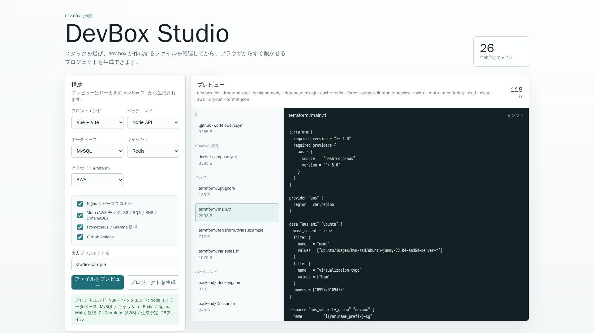
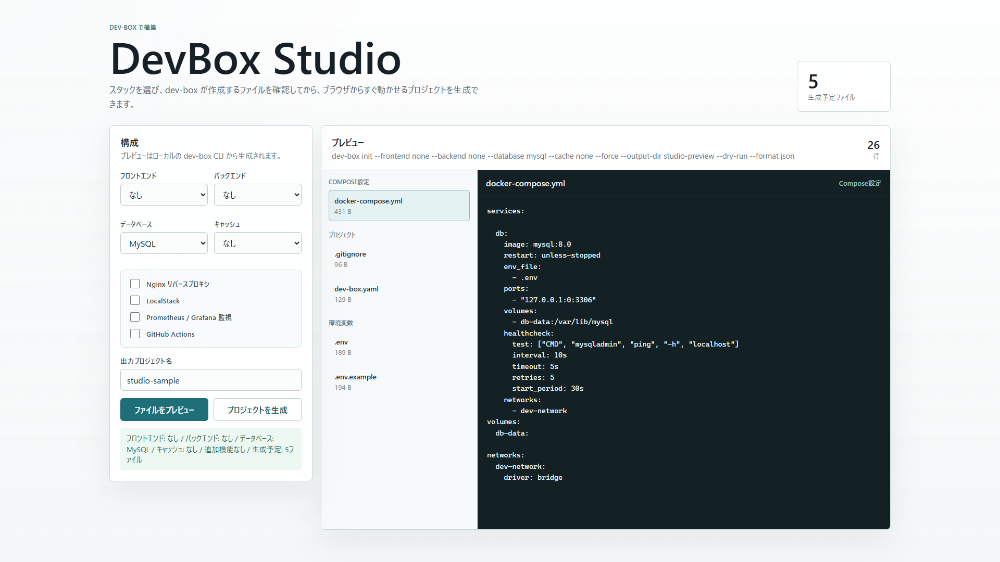
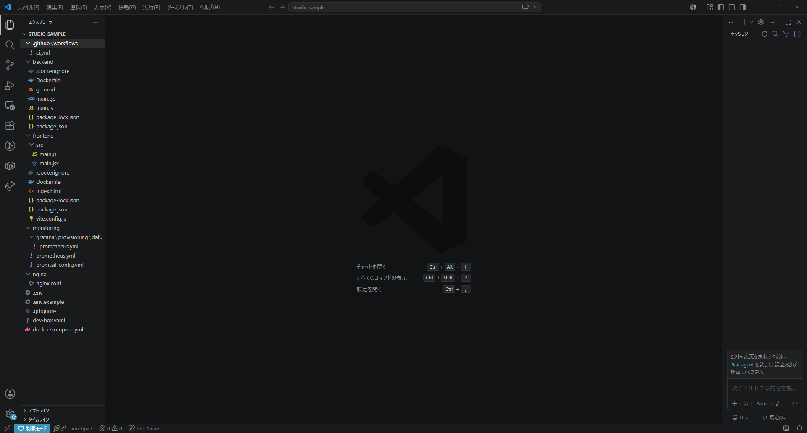
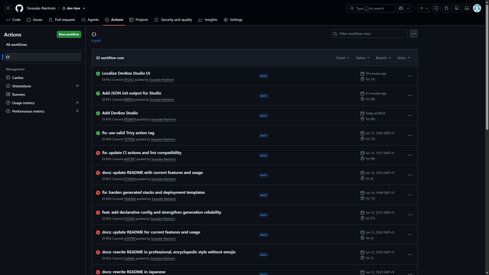

# dev-box

`dev-box` は、プロジェクトで使いたい技術を選ぶだけで、開発を始めるための環境一式を生成する Go 製 CLI です。

フロントエンド、バックエンド、データベース、キャッシュを自由に組み合わせ、Docker Compose、最小構成のアプリケーション、Kubernetes マニフェスト、Terraform、GitHub Actions を同じ設定から生成できます。

## dev-box は何のためのツールか

新しいプロジェクトでは、アプリケーションを書く前に次の準備が必要になります。

- Docker Compose の作成
- フロントエンドと API の初期構築
- データベースや Redis の接続設定
- ヘルスチェックと監視設定
- Kubernetes やクラウド環境のひな形作成
- CI のセットアップ

`dev-box` はこれらの定型作業を自動化し、**ローカル開発からデプロイ準備までの一貫した出発点**を作ります。

主な利用場面は次のとおりです。

- 新規 Web アプリケーションの開発環境をすぐに用意したい
- 複数の技術スタックを比較、検証したい
- チームで同じ開発環境を再現したい
- Docker、Kubernetes、Terraform、CI の学習用ベースが欲しい
- プロジェクト初期構築の手作業と設定漏れを減らしたい

> [!IMPORTANT]
> `dev-box` が生成するものは、安全性を考慮した開発開始用のベースラインです。認証・認可、TLS、DNS、バックアップ、データベース移行、可用性設計、クラウド費用管理まで完了した本番環境ではありません。本番利用前に、生成物を対象環境に合わせてレビューしてください。

## できること

- 対話式ウィザードで技術スタックを選択
- CLI フラグによる非対話生成
- `dev-box.yaml` による宣言的で再現可能な構成管理
- Docker Compose とアプリケーションコードの同時生成
- Docker または Podman による起動、停止、状態確認、ログ表示
- React/Vue の開発環境と本番ビルド用 Dockerfile の生成
- Node.js/Python/Go/PHP/Java の API と Dockerfile の生成
- MySQL/PostgreSQL、Redis、Nginx、LocalStack の追加
- Prometheus、Grafana、Loki、Grafana Alloy の監視構成生成
- Kubernetes の Deployment、Service、PVC、NetworkPolicy 生成
- AWS、GCP、Azure 向け Terraform 構成生成（選択したスタックに合わせたサイズとタグ付き）
- GitHub Actions ワークフロー生成
- 既存ファイル保護、dry-run、出力先指定、アトミックなファイル更新

## 対応スタック

### アプリケーション

| 種別 | 選択値 | 開発時のコンテナポート | 生成イメージのポート |
|---|---|---:|---:|
| Frontend | React + Vite | 5173 | 8080 |
| Frontend | Vue + Vite | 5173 | 8080 |
| Backend | Node.js + Express | 3000 | 8080 |
| Backend | Python + Flask | 8000 | 8080 |
| Backend | Go + `net/http` | 8080 | 8080 |
| Backend | PHP + Apache | 80 | 8080 |
| Backend | Java + `HttpServer` | 8080 | 8080 |

Frontend と Backend には `none` を指定できます。

すべての Backend サンプルは次のエンドポイントを提供します。

| パス | 用途 |
|---|---|
| `/` | サンプルレスポンス |
| `/health` | ヘルスチェック |
| `/metrics` | Prometheus 形式のメトリクス |

### データストアと追加機能

| 種別 | 選択肢 |
|---|---|
| Database | MySQL 8.4、PostgreSQL 16 |
| Cache | Redis 7 |
| Reverse proxy | Nginx 1.30 |
| AWS emulator | LocalStack 3.5（S3、SQS、SNS、DynamoDB） |
| Monitoring | Prometheus、Grafana、Loki、Grafana Alloy |
| CI | GitHub Actions |

使用するコンポーネントのバージョンは [`internal/config/versions.go`](internal/config/versions.go) で管理しています。

## 動作要件

### dev-box のインストールまたはビルド

- Go 1.26 以上

### 生成したローカル環境の実行

- Docker Desktop、または Docker Engine + Docker Compose V2
- Compose 互換環境として Podman も利用可能

追加機能を使う場合は次のツールも必要です。

- Kubernetes: `kubectl` と対象クラスタ
- Terraform: Terraform 1.0 以上と対象クラウドの認証情報

## インストール

### Go install

```bash
go install github.com/Sousuke-Naritomi/dev-box@latest
```

### ソースからビルド

```bash
git clone https://github.com/Sousuke-Naritomi/dev-box.git
cd dev-box
go build -o dev-box .
```

Windows PowerShell:

```powershell
git clone https://github.com/Sousuke-Naritomi/dev-box.git
Set-Location dev-box
go build -o dev-box.exe .
```

インストールを確認します。

```bash
dev-box version
dev-box --help
```

## クイックスタート

### 1. 対話形式で生成する

空の作業ディレクトリで `init` を実行すると、使用する技術を順番に選択できます。

```bash
mkdir my-app
cd my-app
dev-box init
```

### 2. 開発環境を起動する

```bash
dev-box start
dev-box status
```

公開ポートは競合を避けるため自動割り当てされ、`127.0.0.1` のみに公開されます。実際のポートは次のコマンドで確認できます。

```bash
docker compose port frontend 5173
docker compose port api 8080
```

選択した Backend によって API のコンテナポートは異なります。`dev-box status` または生成された `docker-compose.yml` でも確認できます。

### 3. ログを確認する

```bash
dev-box logs
dev-box logs api
```

### 4. 環境を停止する

```bash
dev-box stop
```

`stop` は名前付きボリュームを削除しないため、データベースなどのデータは保持されます。

## DevBox Studio

DevBox Studio は、`dev-box` をブラウザから操作するための補助アプリケーションです。技術スタックを選択すると、生成されるファイルを事前に確認でき、そのままプロジェクトを作成できます。クラウド（Terraform）も選べ、`terraform/` 配下のファイルもプレビューできます。



構成を変更すると、生成予定のファイル数や内容も変わります。たとえば Vue、Node.js、MySQL などの組み合わせを選び、生成結果を画面上で確認できます。



生成後は、フロントエンド、バックエンド、Docker Compose、監視設定、CI 設定などがプロジェクトとして出力されます。



GitHub Actions では、CLI 本体、Studio backend、Studio frontend の検証を実行します。



## 非対話で生成する

CI やスクリプトから利用する場合は、Core 構成をすべて指定します。

```bash
dev-box init \
  --frontend react \
  --backend go \
  --database postgres \
  --cache redis \
  --nginx \
  --monitoring \
  --cicd \
  --cloud aws \
  --output-dir ./my-app
```

選択できる値は次のとおりです。

```text
frontend: react | vue | none
backend:  node | python | go | php | java | none
database: mysql | postgres | none
cache:    redis | none
cloud:    aws | gcp | azure | none   （省略可。既定値は none）
```

すべてが `none` で、LocalStack と Monitoring も無効な空構成は拒否されます。また、Nginx を使用する場合は Frontend または Backend が必要です。

## 設定ファイル

`init` は選択内容を `dev-box.yaml` に保存します。

```yaml
version: 1
frontend: react
backend: go
database: postgres
cache: redis
nginx: true
localstack: false
monitoring: true
cicd: true
cloud: aws
```

`cloud` は省略でき、省略した場合は `none`（Terraform を生成しない）として扱われます。以前に作成した `dev-box.yaml` もそのまま使えます。

このファイルから同じ環境を再生成できます。

```bash
dev-box init --config ./my-app/dev-box.yaml --output-dir ./my-app-copy
dev-box k8s --config ./my-app/dev-box.yaml --output-dir ./k8s-manifests
```

CLI で明示したフラグは設定ファイルより優先されます。

```bash
dev-box init --config dev-box.yaml --backend python --monitoring=false
```

未知のキー、未対応のバージョン、不正な選択値はエラーとして拒否されます。`--force` や `--dry-run` など実行時だけの設定は保存されません。

## コマンド一覧

| コマンド | 内容 |
|---|---|
| `dev-box init` | Compose、アプリケーション、環境変数、監視、CI を生成 |
| `dev-box start` | Compose サービスをバックグラウンド起動 |
| `dev-box stop` | Compose サービスを停止 |
| `dev-box status` | コンテナ状態と公開ポートを表示 |
| `dev-box logs [service]` | 全体または1サービスのログを追跡 |
| `dev-box k8s` | Kubernetes マニフェストを生成 |
| `dev-box deploy` | Terraform ファイルを生成（`--config` でスタックに合わせる） |
| `dev-box version` | CLI とテンプレートスキーマのバージョンを表示 |

### `init` の主なオプション

```text
--frontend string
--backend string
--database string
--cache string
--nginx
--localstack
--monitoring
--cicd
--cloud string   aws | gcp | azure | none
--config string
--force
--dry-run
--format string  text | json  既定値: text
--output-dir string  既定値: .
```

### 共通の生成オプション

- `--dry-run`: ファイルを書き込まず、生成予定の内容を表示
- `--format json`: `--dry-run` と組み合わせて、生成予定ファイルを機械処理しやすい JSON で出力
- `--output-dir`: 生成先ディレクトリを指定
- `--force`: 確認せず既存ファイルを上書き

既存ファイルがある場合、通常は上書き対象を表示して確認します。非対話環境では `--force` がなければ処理を中止します。

JSON 出力は DevBox Studio など、`dev-box` を別ツールから利用する場合に使えます。

```bash
dev-box init --frontend react --backend go --database postgres --cache redis --dry-run --format json
```

## 生成されるファイル

選択内容に応じて、必要なものだけが生成されます。

```text
my-app/
|-- dev-box.yaml
|-- docker-compose.yml
|-- .env
|-- .env.example
|-- .gitignore
|-- frontend/
|   |-- Dockerfile
|   |-- .dockerignore
|   |-- package.json
|   `-- src/
|-- backend/
|   |-- Dockerfile
|   |-- .dockerignore
|   `-- ...
|-- nginx/
|   `-- nginx.conf
|-- monitoring/
|   |-- prometheus.yml
|   |-- config.alloy
|   `-- grafana/provisioning/
|-- terraform/             # --cloud 指定時のみ
|   |-- main.tf
|   |-- variables.tf
|   |-- terraform.tfvars.example
|   `-- .gitignore
`-- .github/workflows/ci.yml
```

### Docker Compose

- ソースコードを bind mount して開発サーバーを起動
- 公開ポートを `127.0.0.1` に限定
- ホスト側ポートを動的割り当て
- DB と Redis にヘルスチェックを設定
- 永続データに名前付きボリュームを使用
- パスワードなどを `.env` から読み込み
- Node.js の依存関係は `npm ci` でインストール

生成される Dockerfile は、Compose の開発用起動とは別に、本番寄りのコンテナイメージを作成するためのものです。アプリケーションコンテナは原則として非 root ユーザーで動作します。

### 秘密情報

Database または Grafana を選択すると、安全な乱数からパスワードを生成します。

- `.env`: 実際の秘密情報。対応環境では権限 `0600` で作成
- `.env.example`: 共有可能なプレースホルダー
- `.gitignore`: 既存内容を維持したまま必要な行だけを追加

Windows では POSIX ファイルモードと NTFS ACL が同一ではないため、必要に応じて `.env` のアクセス権を確認してください。

## Kubernetes

同じ Core 構成から Kubernetes マニフェストを生成できます。

```bash
dev-box k8s --config ./dev-box.yaml --output-dir ./k8s-manifests
```

主な生成物:

```text
k8s-manifests/
|-- namespace.yaml
|-- networkpolicy.yaml
|-- frontend.yaml
|-- api.yaml
|-- db.yaml
`-- cache.yaml
```

選択したサービスに応じて Deployment、Service、PVC、probe、resource limits、NetworkPolicy を生成します。Frontend、API、Redis には次のセキュリティ設定が含まれます。

- `runAsNonRoot: true`
- 固定 `runAsUser`
- `allowPrivilegeEscalation: false`
- Linux capability の全削除
- `seccompProfile.type: RuntimeDefault`

NetworkPolicy は DNS、Frontend から API、API から DB/Redis など、構成上必要な通信のみを追加します。

アプリケーションイメージは利用者がビルドし、クラスタから取得可能なレジストリへ push するか、ローカルクラスタへ loadしてください。Database を選択した場合は適用前に `db-secret` も作成します。

```bash
kubectl apply -f k8s-manifests/namespace.yaml
kubectl -n dev-box-ns create secret generic db-secret \
  --from-literal=password='replace-with-a-secure-password'
kubectl apply -f k8s-manifests/
```

## Terraform

AWS、GCP、Azure の VM と基本ネットワークを作成する Terraform を生成できます。

```bash
dev-box deploy --provider aws --output-dir ./terraform
```

```text
terraform/
|-- main.tf
|-- variables.tf
`-- terraform.tfvars.example
```

### セキュリティ方針

- SSH 許可 CIDR の既定値は空
- HTTP/HTTPS 公開は既定で無効
- AWS/GCP の Public IP は既定で無効
- AWS の outbound CIDR は既定で空
- AWS IMDSv2 と暗号化 root disk を使用
- GCP OS Login と Shielded VM を使用
- Azure は SSH 公開鍵を変数として受け取る

### スタックとの連動

`dev-box.yaml` の `cloud` を設定するか `init --cloud` を指定すると、同じ構成からプロジェクト配下の `terraform/` に生成します。既存の `dev-box.yaml` から後で生成する場合は `--config` を渡します。

```bash
dev-box init --frontend react --backend go --database postgres --cache redis --cloud aws --output-dir ./my-app
dev-box deploy --config ./my-app/dev-box.yaml --output-dir ./my-app/terraform
```

`--provider` を指定した場合は、設定ファイルの `cloud` より優先されます。`--provider` も `cloud` の設定もない状態で、対話できない環境から実行するとエラーになります。

- **インスタンスサイズ**: 選択したサービスの推定メモリから 4 段階の既定値を選びます。Java、MySQL、LocalStack、監視などは大きく見積もります。目安なので、`terraform.tfvars.example` のコメントにある変数で上書きできます。

  | 推定メモリ | AWS | GCP | Azure |
  |---|---|---|---|
  | 〜700 MiB | t3.micro | e2-micro | Standard_B1s |
  | 〜1,500 MiB | t3.small | e2-small | Standard_B1ms |
  | 〜2,600 MiB | t3.medium | e2-medium | Standard_B2s |
  | それ以上 | t3.large | e2-standard-2 | Standard_B2ms |

- **タグ**: インスタンスに構成を表すタグが付きます（AWS は `Stack` タグ、GCP は `stack` ラベル、Azure は `stack` タグ）。例: `react-go-postgres-redis`。
- **リソース名**: `name_prefix`（既定 `devbox`）から決まります。値を変えると、同じアカウントやネットワークに複数の環境を並べられます。GCP のネットワークタグも連動するため、環境間でファイアウォールが共有されません。
- **`terraform/.gitignore`**: `.terraform/`、state、`terraform.tfvars` を除外します。

AWS は送信通信を既定で閉じています。一方で、初回起動時の Docker 導入には外向きの HTTPS が必要です。NAT やプロキシのアドレス範囲を `allowed_egress_cidrs` で許可しないと、導入に失敗します（インスタンスの `/var/log/cloud-init-output.log` に記録されます）。

利用時はサンプルをコピーし、環境に合わせて値を設定します。

```bash
cd terraform
cp terraform.tfvars.example terraform.tfvars
terraform fmt -recursive
terraform init
terraform validate
terraform plan
terraform apply
```

Terraform の対象は VM、基本ネットワーク、Docker のインストールまでです。アプリケーション転送、TLS、DNS、バックアップは別途構成してください。

## CI と監視

### GitHub Actions

`--cicd` を指定すると、生成先プロジェクトに次の検証を行うワークフローを追加します。

- Docker Compose 設定の検証
- Trivy による `CRITICAL` / `HIGH` 脆弱性スキャン（Trivy は GitHub のリリースから取得し、チェックサムを検証して導入します）
- サービスの実起動
- コンテナ状態、health check、HTTP 応答の確認
- 失敗時のログ出力と終了時の後片付け

### Monitoring

`--monitoring` を指定すると次を追加します。

- Prometheus による API `/metrics` の収集
- Grafana の Prometheus と Loki の datasource provisioning
- Grafana Alloy によるログ収集設定（ホストの `/var/log/*.log` を Loki へ送ります）

Alloy は Docker ソケットをマウントせず、`/var/log` を読み取り専用でマウントします。ホストログのマウントは Linux を前提としているため、Docker Desktop では取得できるログ範囲が異なります。コンテナのログ収集は含みません。

## 安全性と信頼性

`init`、`k8s`、`deploy` は共通の安全な書き込み処理を使用します。

- 上書き対象を事前に検出
- `--dry-run` による生成内容の確認
- シンボリックリンクへの上書きを拒否
- 一時ファイルへ書き込んでから rename
- 途中失敗時に既存ファイルをロールバック
- `.gitignore` を置換せず必要な項目だけ追加
- Ctrl+C などのキャンセルを Context 経由で処理

既存プロジェクトへ生成する場合は、先に Git へコミットしておくことを推奨します。

## Docker と Podman の切り替え

`start`、`stop`、`status`、`logs` は `docker` を探し、見つからない場合は `podman` を使用します。明示的に指定する場合は `DOCKER_CMD` を設定します。

```bash
DOCKER_CMD=podman dev-box start
```

PowerShell:

```powershell
$env:DOCKER_CMD = "podman"
dev-box start
```

## 既知の制約

- 生成コードは最小実装であり、認証、認可、業務ロジック、永続化、migration は含みません。
- Compose のホスト側ポートは固定されません。起動後に確認してください。
- Kubernetes のアプリケーションイメージは利用者がビルド、配布、タグ管理する必要があります。
- Kubernetes の Database は StatefulSet ではなく Deployment + PVC です。本番ではマネージド DB や専用 Operator を検討してください。
- Kubernetes の `db-secret` は自動生成されません。
- Frontend の外部公開範囲や Ingress Controller 名前空間はクラスタ要件に合わせて調整してください。
- LocalStack はサービスを起動しますが、S3 bucket などのリソース自体は作成しません。
- AWS/GCP の外部アクセスには Public IP、NAT、踏み台、IAP などの追加設計が必要です。
- Terraform のインスタンスサイズは推定値です。実際の負荷に合わせて変数で調整してください。
- コンテナイメージはバージョンタグ固定であり、digest 固定ではありません。
- LocalStack は 3.5 に固定しています。認証なしで動くコミュニティ版ですが、上流のリポジトリは 2026 年 3 月にアーカイブされ、更新されません。新しいイメージは `LOCALSTACK_AUTH_TOKEN` がないと起動しないため、既定では更新していません。

## dev-box 自体の開発

```bash
go mod tidy
go test ./...
go vet ./...
go build ./...
golangci-lint run ./...
```

Makefile も利用できます。

```bash
make build
make test
make lint
```

主なディレクトリ:

```text
dev-box/
|-- cmd/                  # Cobra コマンド
|-- internal/
|   |-- config/           # 設定、バージョン、バリデーション
|   |-- fs/               # ファイルシステム抽象化
|   |-- generator/        # Compose、K8s、Terraform、CI の生成
|   |-- registry/         # Frontend/Backend 定義
|   `-- security/         # 秘密情報生成
|-- frontend/             # 生成例
|-- backend/              # 生成例
|-- k8s-manifests/        # 生成例
|-- main.go
`-- Makefile
```

テンプレートは `embed.FS` に組み込まれるため、リリース版は単一バイナリで動作します。

## ライセンス

[MIT License](LICENSE)
